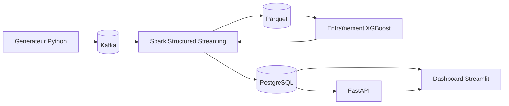

# Real-Time Payment Intelligence & Fraud Detection Platform

Plateforme de traitement de transactions de paiement en quasi temps réel avec détection de fraude.

> **Données 100 % synthétiques.** Aucune donnée bancaire réelle n'est utilisée, et le projet ne reproduit aucun système propriétaire.

## Objectif

Simuler un flux de transactions de paiement, le traiter en continu, détecter les transactions suspectes (règles et Machine Learning), générer des alertes et les afficher dans un dashboard.

## Architecture prévue



## Technologies

Python · Apache Kafka · Spark Structured Streaming · PostgreSQL · Parquet · XGBoost · FastAPI · Streamlit · Docker Compose · Git

## État d'avancement

- [x] Cahier des charges (architecture, modèle de données, stratégie de détection, planning)
- [x] Structure du dépôt et environnement Python
- [x] Générateur de transactions synthétiques (profils clients et marchands, 3 scénarios de fraude)
- [ ] Kafka avec Docker Compose (en cours)
- [ ] Pipeline Spark Structured Streaming (validation, déduplication, DLQ)
- [ ] Stockage PostgreSQL et Parquet
- [ ] Règles de fraude et alertes
- [ ] Dashboard Streamlit (MVP)
- [ ] Modèle XGBoost et scoring
- [ ] API FastAPI
- [ ] Tests, mesures de performance, documentation

## Modèle de transaction (12 champs)

`schema_version`, `transaction_id`, `event_time`, `customer_id`, `merchant_id`, `merchant_category`, `amount`, `currency`, `country`, `channel`, `device_id`, `status`

Les étiquettes de fraude (`is_fraud`, `fraud_type`) ne font pas partie du message : elles restent côté générateur pour éviter le data leakage.

## Scénarios de fraude simulés

| Scénario | Description |
|---|---|
| `card_testing` | Série de petits montants rapprochés, souvent refusés, avec un appareil inconnu |
| `account_takeover` | Gros achat en ligne, dans un pays étranger, avec un appareil inconnu |
| `abnormal_amount` | Montant très supérieur aux habitudes du client |

## Lancer le générateur

```bash
python -m venv .venv
source .venv/Scripts/activate      # Windows (Git Bash)
pip install numpy
python src/generator/generator.py
```

## Structure du dépôt

```
src/        code partagé et générateur
kafka/      configuration Kafka
spark/      jobs de streaming
ml/         entraînement et évaluation
api/        service FastAPI
dashboard/  application Streamlit
sql/        scripts PostgreSQL
tests/      tests
docs/       documentation
```

## Limites

Les données sont simulées : les résultats du modèle ne sont pas transposables tels quels à un environnement de production.